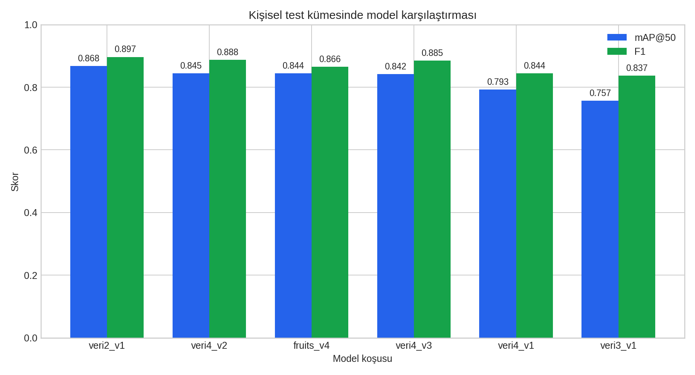
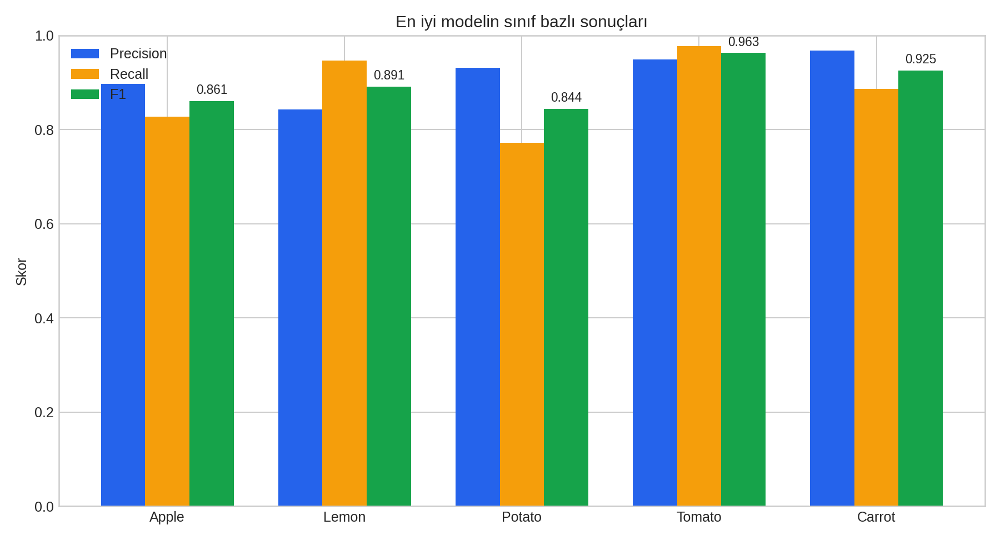
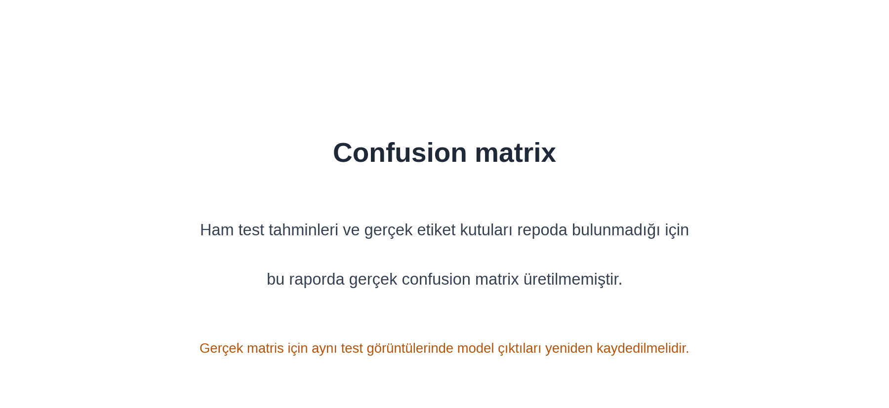

# Meyve ve Sebze Tespiti ve Sayımı Proje Raporu

## 1. Projenin amacı

Bu çalışmanın amacı, görüntülerde bulunan Apple, Lemon, Potato, Tomato ve Carrot nesnelerini otomatik olarak tespit etmek ve her sınıfın adedini hesaplamaktır. Problem türü **nesne tespiti**dir. Model her nesne için sınıf adı, güven skoru ve sınırlayıcı kutu üretir.

## 2. Veri kümesi ve veri hazırlama

Veri, EVREN platformu üzerinde açık kaynak olarak paylaşılmış farklı meyve-sebze kaynaklarının birleştirilmesiyle hazırlanmıştır. Kaynak etiketleri aşağıdaki sabit sınıf sırasına çevrilmiştir:

| ID | Sınıf |
|---:|---|
| 0 | Apple |
| 1 | Lemon |
| 2 | Potato |
| 3 | Tomato |
| 4 | Carrot |

`data_merged.py` ve `merge_dataset_v33.py` etiket sınıflarını eşler, görüntüleri içerik hash'i ile tekilleştirir ve veri sızıntısını azaltmak için train, validation ve test ayrımını korur. Eğitim manifestlerinde split sayıları ile SHA-256 özetleri tutulur.

En iyi model koşusunda 16.218 train, 3.243 validation ve 2.162 test görüntüsü bulunmaktadır. Ayrıca eğitimde kullanılmayan `kendi_test_verim` kümesi modellerin aynı koşullarda karşılaştırılması için kullanılmıştır.

**Veri ve model kaynağı:** [EVREN proje sayfası](https://evren.ssyz.org.tr/projects/01a1ffce-5161-7701-a3ac-c0b9d7102188). Projedeki eğitimler EVREN üzerinde yapılmış, veri ve ağırlıklar platformda açık kaynak olarak paylaşılmıştır.

## 3. Model mimarisi

Ultralytics YOLO11 nesne tespit mimarisi kullanılmıştır. Deneylerin çoğunda `yolo11l`, iki deneyde `yolo11m` temel ağırlığı kullanılmıştır. Model; görüntüden özellik çıkaran backbone, farklı ölçekleri birleştiren neck ve kutu/sınıf skorlarını üreten detection head bölümlerinden oluşur. Bir görüntüde birden fazla nesne bulunabileceği için tek bir softmax çıktısı yerine her tespit için sınıf güven skorları üretilir.

- **Eğitim giriş boyutu:** 800 piksel
- **Kişisel test giriş boyutu:** 640 piksel
- **Sınıf sayısı:** 5
- **Çıktı:** Sınırlayıcı kutu, sınıf ve güven skoru

## 4. Hiperparametreler ve seçim gerekçeleri

| Parametre | Kullanılan değerler | Gerekçe |
|---|---|---|
| Optimizer | AdamW | Büyük ve farklı kaynaklardan gelen veride kararlı güncelleme ve weight decay |
| Learning rate | `lr0=0.001`, `lrf=0.01` | Başlangıçta yeterli öğrenme, son aşamada küçük adımlar |
| Scheduler | Cosine learning rate | Eğitim sonunda daha yumuşak yakınsama |
| Epoch | 150 veya 200 | Modelin yeterince öğrenmesi için |
| Patience | 35 veya 50 | Validation iyileşmesi durduğunda erken durma |
| Batch | 32, 48, 128, 256, 384, 512 | EVREN’de ayrılan GPU sayısına göre fiili değer |
| Görüntü boyutu | 800 | Küçük nesnelerin ayrıntısını korumak için |
| AMP | Açık | GPU belleğini ve eğitim süresini daha verimli kullanmak için |
| Loss katsayıları | `box=7.5`, `cls=0.5`, `dfl=1.5` | Kutu, sınıf ve kutu mesafesi kayıplarını dengelemek için |
| Augmentation | HSV, scale, rotation, translate, mosaic | Işık, açı, uzaklık ve arka plan çeşitliliğini artırmak için |

YOLO detection loss; kutu regresyonu, sınıflandırma ve Distribution Focal Loss bileşenlerini kullanır. Bu nedenle raporda hem kutu konumunu hem de sınıf kararını ölçen metrikler birlikte verilmiştir.

## 5. Eğitim ortamı ve deneyler

Eğitimlerin tamamı EVREN platformunda yürütülmüştür. Manifestlerde Python 3.10.12, CUDA 12.4, Ultralytics 8.3.0 ve NVIDIA H200 bilgileri kayıtlıdır. Dağıtık deneylerde GPU sayısı 1, 2, 4, 6 veya 8 olarak değişmiştir.

Bu teslimde süre bilgileri yalnızca kullanılan en iyi `fruit_vegetables_veri2_v1` modeli için raporlanmıştır:

| Süre / kaynak ölçümü | Veri2 v1 |
|---|---:|
| Eğitim süresi | **7 saat 30 dakika** |
| Ortalama süre | **2 dakika 25 saniye** |
| En hızlı süre | **2 dakika 13 saniye** |
| En yavaş süre | **3 dakika 54 saniye** |
| İşlenen görüntü | **3.1 milyon** |
| Toplam hız | **122 görüntü/s** |
| Peak VRAM | **30.5 GB** |
| GPU kullanımı | **%90** |
| Son learning rate | **7.37×10⁻⁴** |

Uygulama testleri öğrencinin NVIDIA GeForce RTX 4060 Laptop GPU'sunda, `imgsz=640`, `confidence=0.35` ile çalıştırılmıştır. Beş çalıştırmanın GPU çıkarım süreleri 1,756.1–1,878.0 ms aralığında, ortalama **1,808.0 ms (1.81 s)** olarak ölçülmüştür. Eğitim ortamındaki H200 bilgisi eğitim altyapısını, RTX 4060 bilgisi ise uygulama çıkarım bilgisayarını ifade eder.

| Deney | Mimari | Train / val / test | Epoch / patience | Batch / GPU sayısı |
|---|---|---:|---:|---:|
| `fruit_vegetables_veri2_v1` | YOLO11l | 16,218 / 3,243 / 2,162 | 200 / 50 | 32 / 1 |
| `fruit_vegetables_veri3_v1` | YOLO11m | 17,888 / 3,577 / 2,384 | 200 / 50 | 512 / 8 |
| `fruit_vegetables_veri4_v1` | YOLO11l | 25,405 / 3,162 / 1,990 | 200 / 50 | 256 / 4 |
| `fruit_vegetables_veri4_v2` | YOLO11l | 25,405 / 3,162 / 1,990 | 200 / 50 | 128 / 2 |
| `fruit_vegetables_veri4_v3` | YOLO11l | 26,605 / 3,462 / 1,990 | 200 / 35 | 384 / 6 |
| `fruits_vegetables_v4` | YOLO11l | 3,104 / 388 / 388 | 150 / 35 | 48 / 1 |

## 6. Performans değerlendirmesi

Nesne tespiti için Precision, Recall, F1, IoU, mAP@50 ve mAP@50–95 kullanılmıştır. `mAP@50`, IoU=0.50 eşiğindeki ortalama hassasiyeti; `mAP@50–95`, 0.50 ile 0.95 arasındaki eşiklerdeki ortalama hassasiyeti ölçer. Precision yanlış pozitifleri, Recall kaçırılan nesneleri, F1 ise ikisi arasındaki dengeyi gösterir.

| Model | mAP@50 | mAP@50–95 | Precision | Recall | F1 | Mean matched IoU |
|---|---:|---:|---:|---:|---:|---:|
| **fruit_vegetables_veri2_v1** | **0.8677** | **0.5484** | 0.9173 | **0.8816** | **0.8967** | **0.7651** |
| fruit_vegetables_veri4_v2 | 0.8447 | 0.5203 | 0.9207 | 0.8615 | 0.8878 | 0.7522 |
| fruits_vegetables_v4 | 0.8441 | 0.5004 | 0.8907 | 0.8582 | 0.8657 | 0.7483 |
| fruit_vegetables_veri4_v3 | 0.8417 | 0.5256 | 0.9186 | 0.8552 | 0.8851 | 0.7448 |
| fruit_vegetables_veri4_v1 | 0.7930 | 0.4764 | 0.9033 | 0.8149 | 0.8442 | 0.7231 |
| fruit_vegetables_veri3_v1 | 0.7567 | 0.4642 | **0.9311** | 0.7760 | 0.8369 | 0.6993 |



### En iyi modelin sınıf bazlı sonuçları

| Sınıf | mAP@50 | mAP@50–95 | Precision | Recall | F1 | Mean matched IoU |
|---|---:|---:|---:|---:|---:|---:|
| Apple | 0.8141 | 0.4943 | 0.8964 | 0.8278 | 0.8607 | 0.6775 |
| Lemon | 0.9076 | 0.4962 | 0.8428 | 0.9461 | 0.8915 | 0.7636 |
| Potato | 0.7647 | 0.5072 | 0.9310 | 0.7714 | 0.8438 | 0.8029 |
| Tomato | 0.9684 | 0.6463 | 0.9489 | 0.9766 | 0.9625 | 0.8259 |
| Carrot | 0.8837 | 0.5983 | 0.9676 | 0.8861 | 0.9251 | 0.7848 |



En yüksek F1 Tomato sınıfındadır. Potato ve Apple sınıfları daha düşük mAP@50 değerleri nedeniyle iyileştirme alanıdır.

### Confusion matrix

Mevcut test JSON dosyalarında ham görüntü bazlı `gerçek sınıf → tahmin sınıfı` eşleşmeleri yoktur; yalnızca toplu metrikler ve eşleşen kutuların ortalama IoU değeri vardır. Bu nedenle gerçek bir confusion matrix uydurulmamıştır. Aşağıdaki görsel veri durumunu açıkça gösterir. Gerçek matrisi üretmek için test betiğinin her tahmini sınıf eşleşmesiyle birlikte kaydetmesi gerekir. Bu kayıt oluştuğunda repodaki `confusion_matrix.py` betiğiyle grafik üretilebilir.



## 7. Deployment

Flask uygulaması fotoğraf seçme, sürükleyip bırakma, model seçme, confidence eşiği ayarlama, kutulu sonucu gösterme, sınıf adetlerini listeleme ve inference süresini ölçme özelliklerine sahiptir.

Yerel çalıştırma:

```bash
python -m venv .venv
# Windows
.venv\\Scripts\\activate
# Linux/macOS
source .venv/bin/activate
pip install -r web_flask/requirements.txt
python web_flask/app.py
```

Ardından `http://127.0.0.1:5000` açılır. Uygulama GPU varsa CUDA'yı, yoksa CPU'yu seçer. Flask, `models/<model_adı>/best.pt` konumundaki ağırlıkları otomatik keşfeder. Ağırlık dosyası EVREN proje sayfasından alınarak bu konuma konmalıdır.

## 8. Gerçek görüntülerle test ve değerlendirme

Öğrencinin telefonuyla çektiği fotoğraflar `Uygulama_test_icin_fotolar/` klasöründedir. Uygulamada:

1. Beş fotoğraf tek tek yüklenir.
2. Her fotoğraf için gerçek sınıf ve adet elle kaydedilir.
3. Modelin kutulu çıktısı ve tahmin adetleri kaydedilir.
4. Gerçek sonuç ile model sonucu karşılaştırılır.
5. Doğru, eksik ve fazla tespitler; ışık, uzaklık, örtüşme ve arka planla birlikte yorumlanır.

Flask arayüzünde ayrıca **Canlı Kamerayı Aç** düğmesi vardır. Tarayıcı kamera izni verdikten sonra yaklaşık 1.8 saniyede bir kare `/api/predict` uç noktasına gönderilir ve güncel kutulu çıktı gösterilir. Kamera özelliği `localhost` veya HTTPS üzerinde çalışır.

| Uygulama çalıştırması | Fotoğrafta görülen gerçek nesneler | `fruit_vegetables_veri2_v1` çıktısı | GPU süresi | Değerlendirme |
|---|---|---|---:|---|
| `00.44.17 (1).jpeg` | 1 Potato, 1 Carrot | Potato 0.84; Carrot 0.88 | 1,834.5 ms | **2/2 doğru** |
| `00.44.17.jpeg` – elma karesi | 3 Apple | Apple 0.86, 0.85, 0.80 | 1,756.1 ms | **3/3 doğru** |
| `00.44.17.jpeg` – karışık kare | 3 Apple, 2 Lemon; arka planda Potato | Apple 0.86, 0.85, 0.84; Lemon 0.78, 0.69 | 1,801.5 ms | 5 tespit doğru; arka plan Potato eşik altında kalmış olabilir |
| `00.53.31.jpeg` | 1 Apple, 1 Carrot | Apple 0.79; Carrot 0.77 | 1,770.1 ms | **2/2 doğru** |
| `00.53.32 (2).jpeg` | 2 Apple, 2 Potato | Potato 0.91, 0.42; Apple 0.74, 0.66 | 1,878.0 ms | **4/4 doğru** |

Beş çalıştırmanın ortalama çıkarım süresi **1,808.0 ms**'dir. Aynı WhatsApp dosya adının iki farklı ekran görüntüsünde görünmesi iki farklı uygulama çalıştırmasının ayrı ayrı raporlanması içindir. Gerçek nesne adetleri fotoğraflar ekranda incelenerek elle belirlenmiş, model çıktıları uygulama ekranından okunmuştur. Bu nedenle tablo saha testi karşılaştırmasıdır; piksel düzeyinde gerçek kutu anotasyonu yerine geçmez.

Özellikle 0.42 güven skoruyla gelen Potato ve arka planda kalan nesne, confidence eşiğinin sonuçlara etkisini göstermektedir. Işık, nesne boyutu, örtüşme ve arka plan karmaşası düşük güvenli veya eksik tespitlerin olası nedenleridir.

## 9. Sonuç

YOLO11 tabanlı sistem, beş sınıflı meyve-sebze nesne tespiti görevinde en iyi `fruit_vegetables_veri2_v1` modeliyle mAP@50=0.8677 ve F1=0.8967 değerlerine ulaşmıştır. Model EVREN üzerinde eğitilmiş, veri ve modeller açık kaynak olarak paylaşılmış, test sonuçları JSON olarak kaydedilmiş ve Flask uygulamasıyla kullanılabilir hale getirilmiştir. Beş gerçek uygulama çalıştırmasında ortalama çıkarım süresi 1.81 saniyedir. Uygulama sonuçları tabloya işlenmiş; düşük güvenli ve arka planda kalan nesneler ayrıca yorumlanmıştır.

## 10. Kaynaklar

- [EVREN platformu](https://evren.ssyz.org.tr/)
- [EVREN proje sayfası](https://evren.ssyz.org.tr/projects/01a1ffce-5161-7701-a3ac-c0b9d7102188)
- [Ultralytics YOLO11](https://docs.ultralytics.com/models/yolo11)
- [Ultralytics validation metrics](https://docs.ultralytics.com/modes/val/)
- Proje içindeki `test_sonuclari_json/` JSON kayıtları ve eğitim manifestleri
