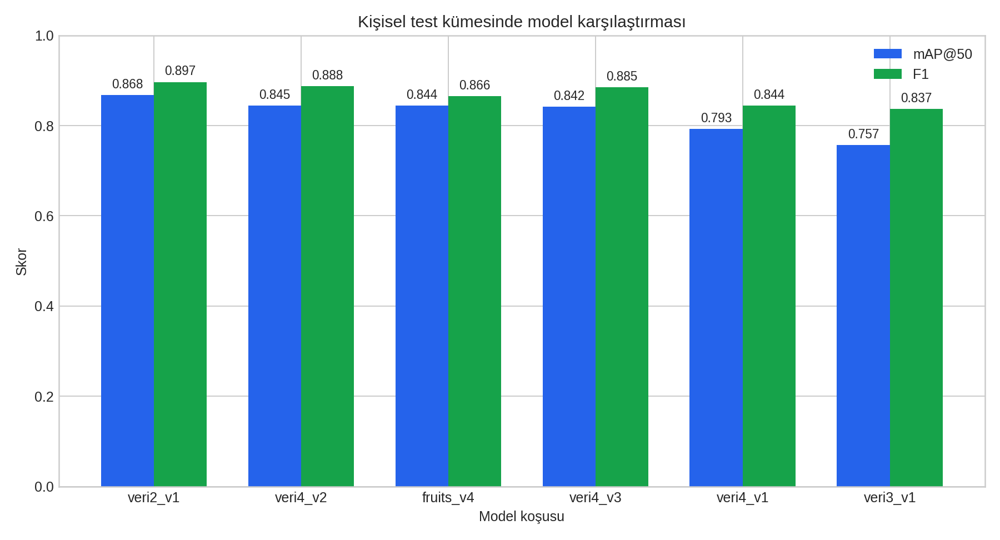
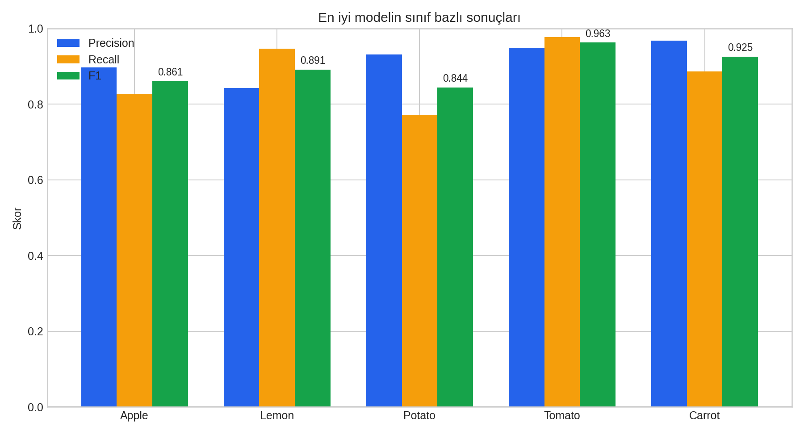
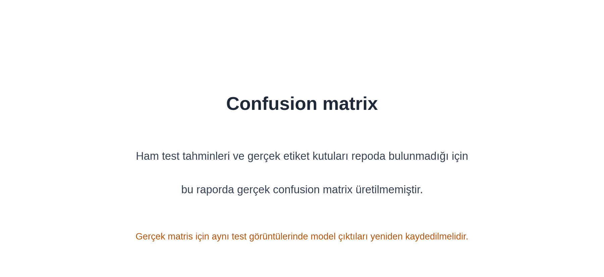
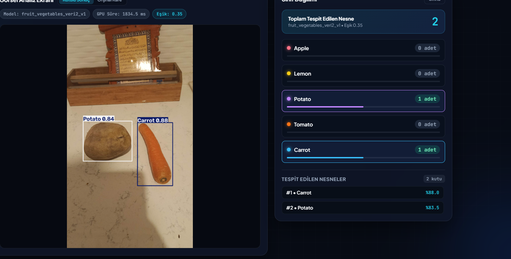
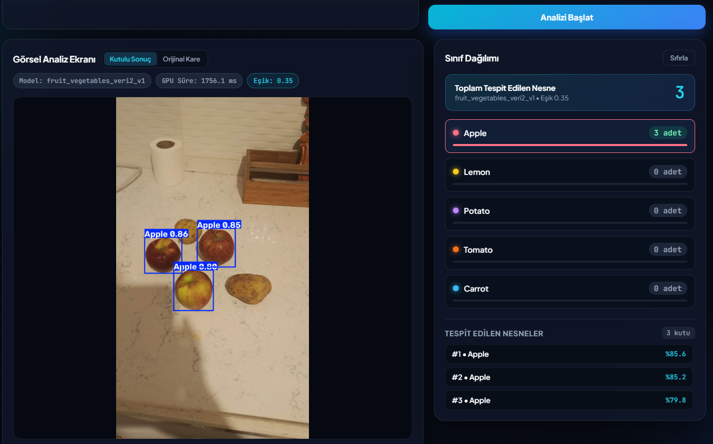
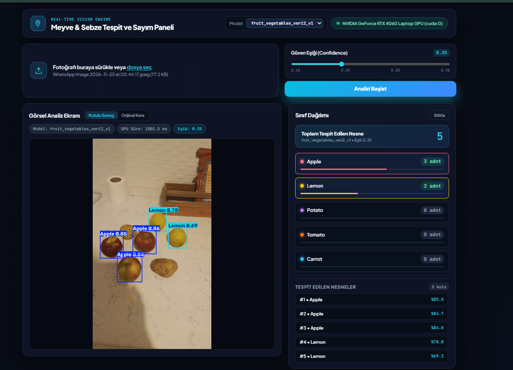
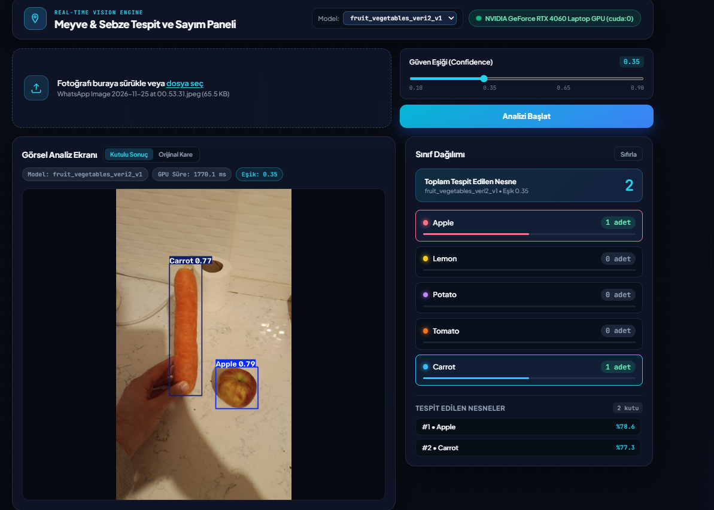
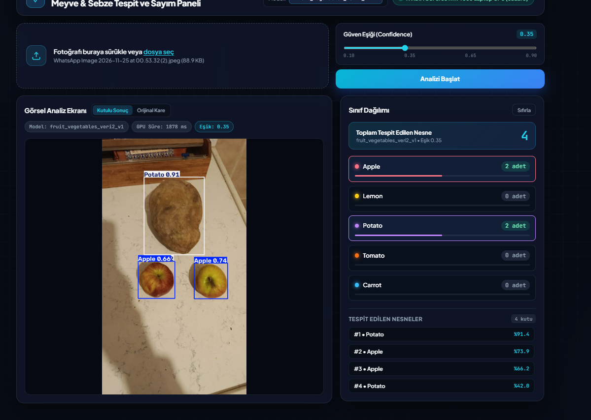
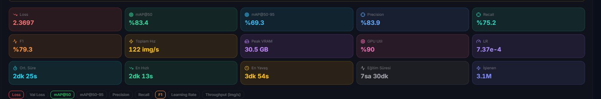

# Meyve ve Sebze Tespit ve Sayım Sistemi

Bu proje, tek bir fotoğraf veya kamera görüntüsündeki **Apple, Lemon, Potato, Tomato ve Carrot** nesnelerini YOLO11 ile bulur, sınıflandırır ve adetlerini hesaplar. Proje; veri hazırlama, farklı model eğitimleri, bağımsız test, grafiksel değerlendirme ve Flask tabanlı uygulama aşamalarını birlikte içerir.

## Kısa sonuç

`kendi_test_verim` üzerinde en iyi genel sonuç `fruit_vegetables_veri2_v1` modeliyle alınmıştır:

- **mAP@50:** 0.8677
- **mAP@50–95:** 0.5484
- **Precision:** 0.9173
- **Recall:** 0.8816
- **F1:** 0.8967
- **Mean matched IoU:** 0.7651
- **Tam test değerlendirme süresi:** 89.27 saniye

Bu son süre bütün test işi içindir; tek görüntünün tahmin süresi bilgisayarın CPU/GPU durumuna göre Flask uygulamasında ayrıca ölçülür.

## Teslimde bulunan dosyalar

| İçerik | Konum |
|---|---|
| Bu açıklama | `README.md` |
| Ödev raporu | [`RAPOR.md`](RAPOR.md) |
| Flask uygulaması | [`web_flask/`](web_flask/) |
| Test JSON sonuçları | [`test_sonuclari_json/`](test_sonuclari_json/) |
| Uygulama fotoğrafları | [`Uygulama_test_icin_fotolar/`](Uygulama_test_icin_fotolar/) |
| Deney grafikleri | [`docs/figures/`](docs/figures/) |
| Veri birleştirme ve etiket eşleme | `data_merged.py`, `merge_dataset_v33.py` |
| Veri bölme ve kontrol | `split.py`, `kontrol.py` |
| Kişisel test değerlendirmesi | `kendi_verim_test.py` 
| Confusion matrix üretimi | `confusion_matrix.py` |
| Kamera ile veri toplama | `kamera_app.py`, `otonom_foto.py` |
| Model kayıtları | [`models/README.md`](models/README.md) |

## Ödev isterleriyle eşleşme

| Ödev maddesi | Projedeki karşılığı |
|---|---|
| Problem / task | Beş sınıflı nesne tespiti ve nesne sayımı |
| Model architecture | Ultralytics YOLO11; çoğu deney `yolo11l`, iki deney `yolo11m` |
| Dataset | Farklı açık kaynak veri kümelerinin sınıf sırası eşlenerek birleştirilmesi ve bağımsız `kendi_test_verim` kümesi |
| Dataset URL | Eğitim ve veri sürümleri EVREN projesinde paylaşılmıştır: [EVREN proje sayfası](https://evren.ssyz.org.tr/projects/01a1ffce-5161-7701-a3ac-c0b9d7102188) |
| Train / validation / test | Her deneyde ayrı split; manifestlerde görüntü sayıları ve SHA-256 özetleri kayıtlı |
| Hyperparameters | Aşağıdaki deney tablosunda tek tek verilmiştir |
| Optimizer / loss | AdamW; box, class ve DFL bileşenli YOLO detection loss |
| Metrikler | Precision, Recall, F1, IoU, mAP@50 ve mAP@50–95 |
| Eğitim ortamı | EVREN platformu; Slurm + Apptainer, NVIDIA H200, CUDA 12.4, Python 3.10.12, Ultralytics 8.3.0 |
| Deployment | Flask; fotoğraf yükleme, model seçimi, confidence ayarı ve canlı kamera testi |
| Beş gerçek fotoğraf | `Uygulama_test_icin_fotolar/`; raporda gerçek etiket ve model çıktısı tablosu için kayıt alanı bulunur |
| Repository | [GitHub deposu](https://github.com/Yusuf5825/Fruit_Vegtetables_Detect) |

## En iyi model: eğitim ve çıkarım süreleri

Bu teslimde süre bilgileri yalnızca **fruit_vegetables_veri2_v1** için raporlanmıştır. Eğitim ekranındaki kayıtlar:

| Ölçüm | Veri2 v1 sonucu |
|---|---:|
| Eğitim süresi | **7 saat 30 dakika** |
| Ortalama süre | **2 dakika 25 saniye** |
| En hızlı süre | **2 dakika 13 saniye** |
| En yavaş süre | **3 dakika 54 saniye** |
| İşlenen görüntü | **3.1 milyon** |
| Toplam hız | **122 görüntü/s** |
| Peak VRAM | **30.5 GB** |
| GPU kullanımı | **%90** |
| Son öğrenme oranı | **7.37×10⁻⁴** |

Uygulamanın NVIDIA GeForce RTX 4060 Laptop GPU üzerinde, `imgsz=640` ve `confidence=0.35` ayarlarıyla alınan beş gerçek görüntü çalıştırmasında çıkarım süreleri **1,756.1–1,878.0 ms**, ortalama **1,808.0 ms (1.81 s)** olarak ölçülmüştür. Bu süre tek görüntü içindir; ilk model yükleme süresi ayrıca değerlendirilmemiştir.

## EVREN üzerinde eğitim ve açık kaynak paylaşımı

Bu projedeki bütün eğitimler **Savunma Sanayii Başkanlığı EVREN platformunda** gerçekleştirilmiştir. Eğitim işleri platformun Slurm ve Apptainer tabanlı HPC altyapısında yürütülmüş, deney ayarları ve model kayıtları tutulmuş, veri kümeleri ve eğitilmiş model ağırlıkları proje içinde açık kaynak olarak paylaşılmıştır.

EVREN; veri yönetimi, etiketleme, dağıtık model eğitimi, model paylaşımı ve görüntü çıkarımı akışlarını aynı platformda sunar. Bu nedenle manifestlerde görülen H200, CUDA ve paket bilgileri eğitim ortamına aittir; Flask uygulamasını çalıştırmak için aynı donanım zorunlu değildir.

- Proje: [EVREN Fruit and Vegetables Detect](https://evren.ssyz.org.tr/projects/01a1ffce-5161-7701-a3ac-c0b9d7102188)
- Platform: [EVREN](https://evren.ssyz.org.tr/)

## Sınıf yapısı

| Class ID | Sınıf |
|---:|---|
| 0 | Apple |
| 1 | Lemon |
| 2 | Potato |
| 3 | Tomato |
| 4 | Carrot |

Veri birleştirme betikleri farklı kaynaklardaki sınıf numaralarını bu sabit sıraya çevirir. İçerik tabanlı SHA-256 kontrolü aynı görüntünün farklı split'lerde tekrarlanmasını azaltmak için kullanılır.

## Deney konfigürasyonları

Aşağıdaki değerler incelenen manifestlerdeki fiili (`effective`) eğitim ayarlarıdır. `train / val / test` sütunundaki değerler görüntü sayısını gösterir.

| Deney | Mimari | Train / val / test | Epoch / patience | Batch / world size | Weight decay | Augmentation: hsv(h,s,v) / scale / degrees / translate / mosaic |
|---|---|---:|---:|---:|---:|---|
| `fruit_vegetables_veri2_v1` | YOLO11l | 16,218 / 3,243 / 2,162 | 200 / 50 | 32 / 1 | 0.0005 | 0.015 / 0.70 / 0.40; 0.50; 10; 0.10; 1.0 |
| `fruit_vegetables_veri3_v1` | YOLO11m | 17,888 / 3,577 / 2,384 | 200 / 50 | 512 / 8 | 0.0005 | 0.010 / 0.30 / 0.20; 0.20; 5; 0.05; 0 |
| `fruit_vegetables_veri4_v1` | YOLO11l | 25,405 / 3,162 / 1,990 | 200 / 50 | 256 / 4 | 0.0005 | 0.010 / 0.30 / 0.20; 0.20; 5; 0.05; 0 |
| `fruit_vegetables_veri4_v2` | YOLO11l | 25,405 / 3,162 / 1,990 | 200 / 50 | 128 / 2 | 0.001 | 0.010 / 0.45 / 0.30; 0.35; 10; 0.10; 0.6 |
| `fruit_vegetables_veri4_v3` | YOLO11l | 26,605 / 3,462 / 1,990 | 200 / 35 | 384 / 6 | 0.001 | 0.010 / 0.45 / 0.30; 0.35; 10; 0.10; 0.6 |
| `fruits_vegetables_v4` | YOLO11l | 3,104 / 388 / 388 | 150 / 35 | 48 / 1 | 0.0005 | 0.015 / 0.70 / 0.40; 0.50; 0; 0.10; 1.0 |

### Hiperparametrelerin kısa gerekçesi

- **YOLO11l / YOLO11m:** Nesne tespitinde kutu ve sınıf skorlarını birlikte üretir. `l` modeli daha yüksek kapasite, `m` modeli daha düşük hesaplama maliyeti için karşılaştırılmıştır.
- **Girdi boyutu 800:** Küçük meyve ve sebze nesnelerinin ayrıntısını korumak için seçilmiştir. Kişisel testte 640 kullanılarak uygulama hızına uygun değerlendirme yapılmıştır.
- **AdamW:** Büyük ve farklı kaynaklardan gelen veri üzerinde öğrenme oranını kararlı güncellemek ve weight decay ile aşırı uyumu azaltmak için seçilmiştir.
- **lr0=0.001 ve cosine schedule:** Başlangıçta yeterli öğrenme adımı, eğitim sonunda daha küçük adımlarla daha kararlı yakınsama sağlamak için kullanılmıştır.
- **200 epoch, patience 50 veya 35:** Modelin yeterince öğrenmesine izin verirken validation iyileşmesi durduğunda erken durmayı mümkün kılar.
- **Batch ve world size:** EVREN’de ayrılan H200 GPU sayısına göre fiilen değişmiştir; bu nedenle tüm deneylerde aynı değildir.
- **HSV, scale, rotation, translate ve mosaic:** Işık, kamera mesafesi, açı ve arka plan değişimlerine karşı genellemeyi artırmak için kullanılmıştır. `veri4_v2` ve `veri4_v3` koşullarında arka plan ve geometrik çeşitlilik artırılmıştır.
- **AMP:** Hız ve GPU belleği kullanımını iyileştirmek için etkinleştirilmiştir.
- **box=7.5, cls=0.5, dfl=1.5:** Sırasıyla kutu konumu, sınıf doğruluğu ve kutu mesafesi dağılımı kayıplarının ağırlıklarıdır.

## Kişisel test sonuçları

| Model | mAP@50 | mAP@50–95 | Precision | Recall | F1 | Mean matched IoU |
|---|---:|---:|---:|---:|---:|---:|
| **fruit_vegetables_veri2_v1** | **0.8677** | **0.5484** | 0.9173 | **0.8816** | **0.8967** | **0.7651** |
| fruit_vegetables_veri4_v2 | 0.8447 | 0.5203 | 0.9207 | 0.8615 | 0.8878 | 0.7522 |
| fruits_vegetables_v4 | 0.8441 | 0.5004 | 0.8907 | 0.8582 | 0.8657 | 0.7483 |
| fruit_vegetables_veri4_v3 | 0.8417 | 0.5256 | 0.9186 | 0.8552 | 0.8851 | 0.7448 |
| fruit_vegetables_veri4_v1 | 0.7930 | 0.4764 | 0.9033 | 0.8149 | 0.8442 | 0.7231 |
| fruit_vegetables_veri3_v1 | 0.7567 | 0.4642 | **0.9311** | 0.7760 | 0.8369 | 0.6993 |



### En iyi modelin sınıf bazlı sonuçları

| Sınıf | mAP@50 | mAP@50–95 | Precision | Recall | F1 | Mean matched IoU |
|---|---:|---:|---:|---:|---:|---:|
| Apple | 0.8141 | 0.4943 | 0.8964 | 0.8278 | 0.8607 | 0.6775 |
| Lemon | 0.9076 | 0.4962 | 0.8428 | 0.9461 | 0.8915 | 0.7636 |
| Potato | 0.7647 | 0.5072 | 0.9310 | 0.7714 | 0.8438 | 0.8029 |
| Tomato | 0.9684 | 0.6463 | 0.9489 | 0.9766 | 0.9625 | 0.8259 |
| Carrot | 0.8837 | 0.5983 | 0.9676 | 0.8861 | 0.9251 | 0.7848 |



Tomato en yüksek F1 değerine sahiptir. Potato ve Apple sınıflarında mAP@50 daha düşük olduğu için bu sınıflar benzer görünümlü örnekler, farklı ışık koşulları ve daha çeşitli arka planlarla güçlendirilebilir.

### Confusion matrix durumu

Gerçek bir confusion matrix oluşturmak için aynı test görüntülerindeki her gerçek kutunun ve model tahmininin sınıf bazlı eşleştirmeleri gerekir. Mevcut JSON kayıtlarında toplu Precision/Recall/mAP ve IoU değerleri vardır; ham görüntü-tahmin eşleşmeleri bulunmamaktadır. Bu nedenle yanlış bir matris üretmemek için gerçek confusion matrix uydurulmamış, durum görsel olarak aşağıda belirtilmiştir.



Gerçek confusion matrix için `confusion_matrix.py` kullanılabilir. Önce test betiği her tahmin için `true_class` ve `predicted_class` çiftlerini JSON olarak kaydetmeli, ardından `python confusion_matrix.py --input pairs.json --output confusion_matrix.png` çalıştırılmalıdır.

## Flask uygulaması ve canlı kamera testi

### Tek tıkla çalıştırma

Kullanıcıların kütüphaneleri tek tek arayıp kurmasına gerek yoktur. Repo klasöründe:

- **Windows:** `run_flask.bat` dosyasına çift tıklayın. İlk çalıştırmada bağımlılıklar otomatik kurulur, sonraki açılışlarda doğrudan sunucu başlar ve tarayıcı açılır.
- **Linux/macOS:** `chmod +x run_flask.sh && ./run_flask.sh` çalıştırın.

İnternet bağlantısı yalnızca ilk kurulumda Python paketlerini almak için gerekir. Model ağırlığı repo içinde parçalara ayrılmıştır ve Flask tarafından otomatik birleştirilir.

Elle çalıştırmak isteyenler için:

```bash
cd Fruit_Vegtetables_Detect
python -m venv .venv
# Windows:
.venv\\Scripts\\activate
# Linux/macOS:
source .venv/bin/activate
pip install -r web_flask/requirements.txt
python web_flask/app.py
```

Tarayıcıdan `http://127.0.0.1:5000` adresini açın. Uygulama:

1. Fotoğraf sürükleyip bırakmayı veya dosya seçmeyi,
2. Model seçmeyi,
3. Confidence eşiğini değiştirmeyi,
4. Kutulu çıktıyı ve sınıf sayılarını göstermeyi,
5. **Canlı Kamerayı Aç** düğmesiyle kameradan yaklaşık 1.8 saniyede bir kare alıp tahmin yapmayı destekler.

Kamera için tarayıcı izni gerekir. Uygulama GPU varsa CUDA'yı, yoksa CPU'yu otomatik seçer. Kamera testi yalnızca `localhost` veya HTTPS üzerinde çalışır.

### Model ağırlıklarının otomatik hazırlanması

Teslimin ana ağırlığı **fruit_vegetables_veri2_v1** modelidir. GitHub dosya boyutu sınırı nedeniyle `best.pt` dosyası repoda `models/fruit_vegetables_veri2_v1/parts/` altında parçalara ayrılmış olarak tutulur. Flask uygulaması ilk açılışta bu parçaları otomatik birleştirip `.model_cache/fruit_vegetables_veri2_v1/best.pt` dosyasını oluşturur; öğrencinin ayrıca model indirmesi gerekmez. İsterseniz tek dosya kullanımı için ağırlığı `models/fruit_vegetables_veri2_v1/best.pt` olarak da koyabilirsiniz.

Diğer deneylerin ayrıntıları ve açık model kayıtları EVREN proje sayfasında yer alır. Canlı uygulama varsayılan olarak veri2 v1 modelini seçer.

## Gerçek görüntülerle test ve değerlendirme

Ödev yönergesindeki beş telefon fotoğrafı `Uygulama_test_icin_fotolar/` altında tutulur. Her fotoğraf için gerçek sınıf ve adet, model tahmini, doğru/eksik/fazla tespit ve anotasyonlu sonuç görseli raporda verilmelidir. Bu karşılaştırmanın güvenilir olması için fotoğraflar uygulamadan geçirildikten sonra aşağıdaki tablo tahmin çıktılarıyla doldurulmalıdır:

| Uygulama çalıştırması | Fotoğrafta görülen nesneler | Model çıktısı (conf=0.35) | GPU çıkarım süresi | Değerlendirme |
|---|---|---|---:|---|
| `00.44.17 (1).jpeg` | 1 Potato, 1 Carrot | 1 Potato (0.84), 1 Carrot (0.88) | 1,834.5 ms | **2/2 doğru** |
| `00.44.17.jpeg` – elma karesi | 3 Apple | 3 Apple (0.86, 0.85, 0.80) | 1,756.1 ms | **3/3 doğru** |
| `00.44.17.jpeg` – karışık kare | 3 Apple, 2 Lemon; arka planda Potato | 3 Apple (0.86, 0.85, 0.84), 2 Lemon (0.78, 0.69) | 1,801.5 ms | 5 tespit doğru; arka plandaki Potato eşik altında kalmış olabilir |
| `00.53.31.jpeg` | 1 Apple, 1 Carrot | 1 Apple (0.79), 1 Carrot (0.77) | 1,770.1 ms | **2/2 doğru** |
| `00.53.32 (2).jpeg` | 2 Apple, 2 Potato | 2 Apple (0.74, 0.66), 2 Potato (0.91, 0.42) | 1,878.0 ms | **4/4 doğru** |

Beş çalıştırmanın ortalama çıkarım süresi **1,808.0 ms**'dir. Aynı WhatsApp dosya adının iki farklı uygulama ekranında görünmesi nedeniyle iki ayrı çalıştırma ayrıca raporlanmıştır. Değerlendirme, ekrandaki nesnelerin elle gözlemlenen sınıf/adet bilgisi ile yapılmıştır; gerçek kutu anotasyonu bulunmadığı için bu sonuçlar saha testi niteliğindedir. Düşük güvenli Potato (0.42) ve arka planda kalan nesneler, confidence eşiğinin tespit sayısını nasıl etkilediğini göstermektedir.

### Uygulama test kanıtları

| Kanıt | Görsel |
|---|---|
| Potato + Carrot |  |
| Üç Apple |  |
| Apple + Lemon karışık kare |  |
| Apple + Carrot |  |
| Apple + Potato |  |

Eğitim ekranındaki doğrulanmış veri2 v1 süre ve kaynak ölçümleri: .

Işık, nesne boyutu, örtüşme ve arka plan karmaşası başarısız veya düşük güvenli tespitlerin temel nedenleridir.

## Sınırlılıklar ve sonraki adım

- Süre karşılaştırması yalnızca teslimde kullanılan `fruit_vegetables_veri2_v1` için raporlanmıştır; diğer koşuların süreleri rapora dahil edilmemiştir.
- Confusion matrix için ham gerçek sınıf–tahmin sınıfı eşleşme dosyası bulunmadığından, yanıltıcı bir matris üretilmemiştir; veri durumu görseli ve üretim betiği repodadır.
- Uygulama test tablosu beş gerçek çalıştırmanın model çıktıları ve ekran görüntülerindeki gözlemlerle doldurulmuştur.
- Veri ve eğitim kayıtları EVREN'de, ana `veri2_v1` ağırlığı ise GitHub'da otomatik birleştirilen parçalarla teslim edilmiştir.

## Kaynaklar

1. [EVREN platformu](https://evren.ssyz.org.tr/)
2. [EVREN proje sayfası](https://evren.ssyz.org.tr/projects/01a1ffce-5161-7701-a3ac-c0b9d7102188)
3. [Ultralytics YOLO11](https://docs.ultralytics.com/models/yolo11)
4. [Ultralytics validation metrics](https://docs.ultralytics.com/modes/val/)
